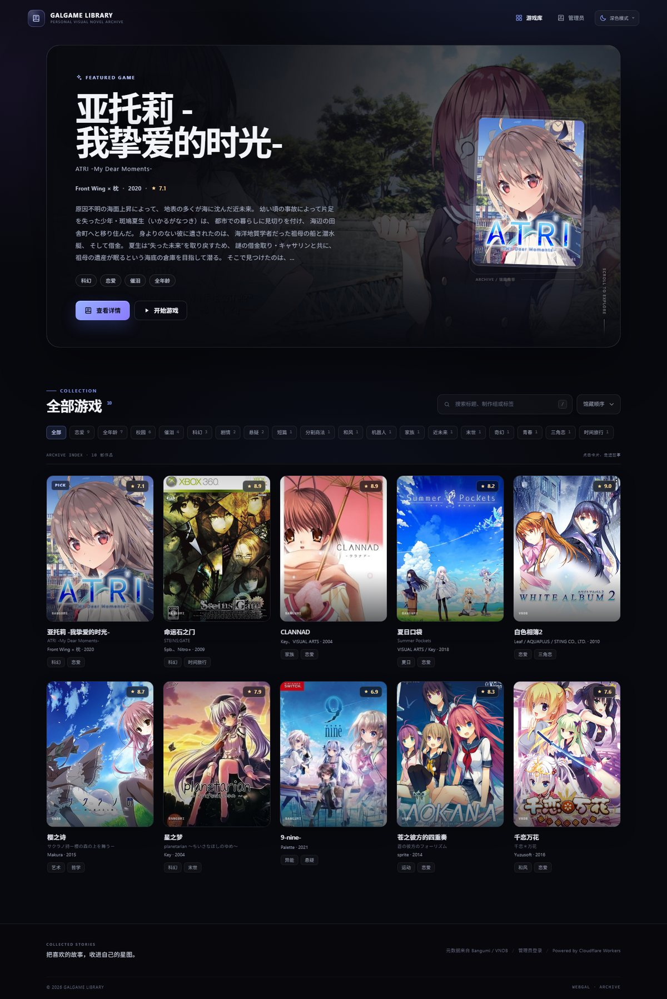
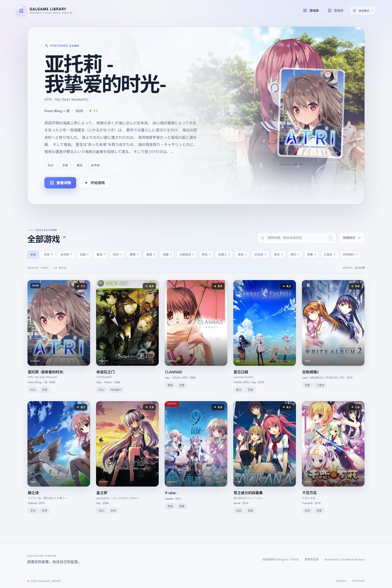
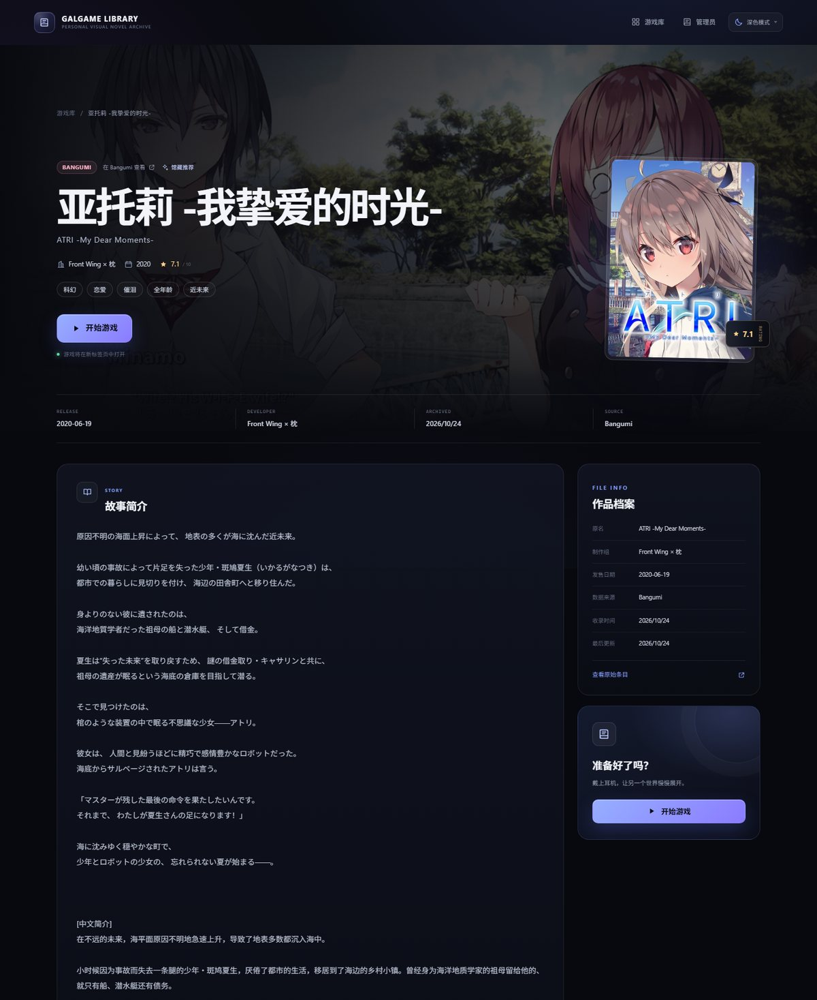
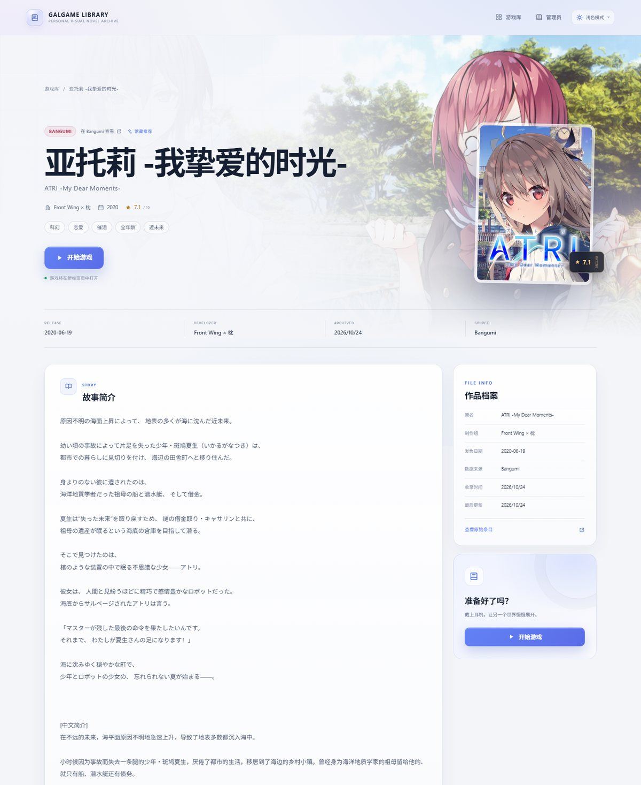
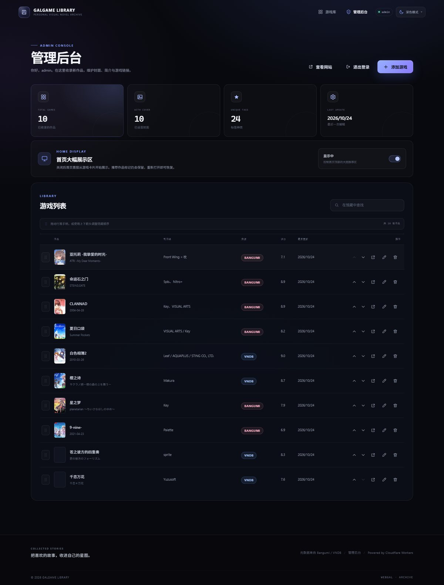
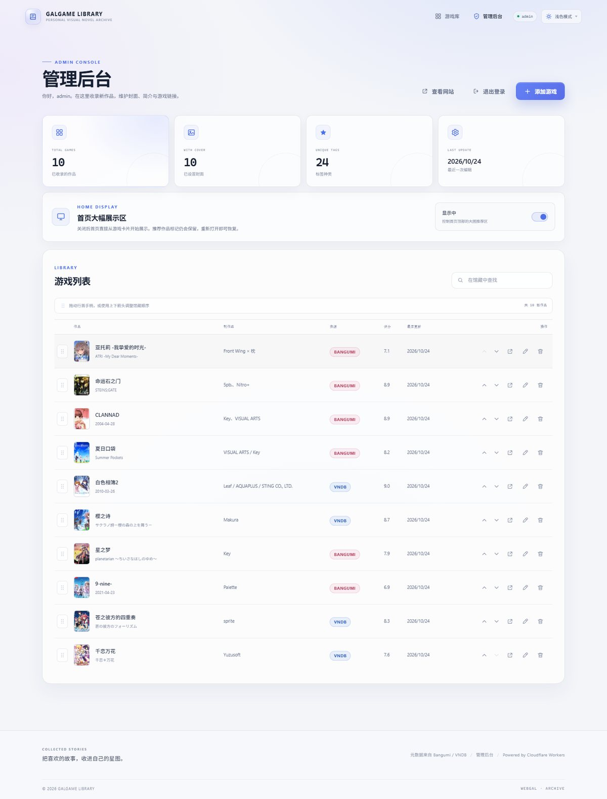
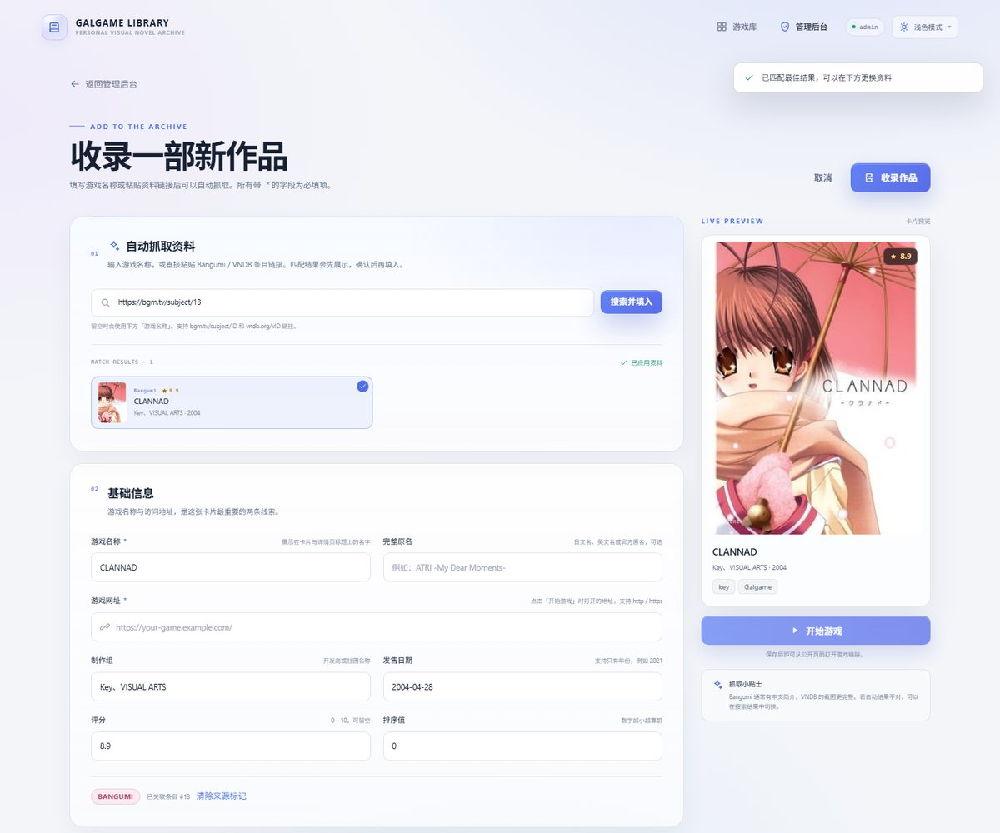

# GALGAME LIBRARY

一个可以部署在 **Cloudflare Workers** 上的个人网页版 Galgame 收藏馆。

深色电影感书库、浅色纸感主题、竖版游戏卡片、详情页大图、一键启动游戏，以及带 Bangumi / VNDB 自动资料抓取的管理后台。

> 技术栈：Cloudflare Workers + D1 + Hono / React 19 + Vite

## 界面预览

<p align="center">
  
  
</p>
<p align="center"><sub>深色模式 · 浅色模式</sub></p>

<details>
<summary>查看详情页、管理后台与添加游戏界面</summary>





<p align="center">
  
  
</p>



</details>

> 截图中使用本地演示数据，正式部署后请添加你自己的游戏。

---

## 功能

- **深色 / 浅色双主题**：右上角可切换「跟随系统 / 浅色 / 深色」，选择保存在 `localStorage`；首次访问跟随系统外观，不会出现主题闪烁。
- **首页大幅展示区开关**：管理员可以在后台关闭首页顶部的推荐大图，让游戏卡片直接成为首屏内容。
- **馆藏顺序管理**：后台支持拖拽行首手柄或使用上下箭头调整作品顺序，首页「馆藏顺序」会同步生效。
- **游戏卡片书库**：首页以封面卡片展示全部作品，支持关键词搜索、标签筛选、评分 / 名称 / 收录时间排序。
- **作品详情页**：展示横幅、封面、原名、制作组、发售日期、评分、标签、完整简介和画面截图；点击「开始游戏」在新标签页打开游戏网址。
- **管理员登录**：密码保存在 Worker Secret 中，登录后获得 7 天有效的 HttpOnly 签名 Cookie；访客只能浏览。
- **后台管理**：添加、编辑、删除作品；设置馆藏推荐；维护排序值。
- **自动抓取资料**：输入游戏名称后同时查询 **Bangumi** 与 **VNDB**，自动填入完整名称、原名、封面、制作组、发售日期、评分、标签、简介与截图。
  - 也可以直接粘贴 `https://bgm.tv/subject/13` 或 `https://vndb.org/v17` 这样的条目链接来精确识别。
  - Bangumi 的 R18 / NSFW 条目默认不会返回给未认证请求；配置可选的 `BANGUMI_ACCESS_TOKEN` 后才会出现在搜索和链接解析结果中（账号需注册满 60 天）。
  - VNDB 的 NSFW 条目不依赖 Bangumi 令牌，通常可以直接搜到。
  - Bangumi 通常有更完整的中文资料；VNDB 的截图更丰富。
  - 如果 Bangumi 条目包含 VNDB 链接（或标题能精确匹配），会自动补充 VNDB 的画面截图。
  - 所有抓取结果都会先显示候选列表，可以一键切换资料源，不会直接写入数据库。
- **图片代理缓存**：Bangumi / VNDB 的图片通过 Worker 代理加载并缓存 7 天，避免外链防盗链和跨域问题，也让卡片加载更快。
- **响应式布局**：桌面端、平板和手机均有适配。

---

## 本地运行

### 环境要求

- Node.js **22.5+**（推荐 22 或 24）
- pnpm（推荐）

### 1. 安装依赖

```bash
pnpm install
```

### 2. 准备本地管理员密码

仓库里已经有一份仅供本地开发的 `.dev.vars`：

```env
ADMIN_USERNAME=admin
ADMIN_PASSWORD=admin123
SESSION_SECRET=local-dev-only-secret-please-change-before-deploying-9f4c2a7d
# 可选，用于获取 Bangumi R18 条目
BANGUMI_ACCESS_TOKEN=
```

如需修改，编辑 `.dev.vars`，或者从模板重新复制：

```powershell
Copy-Item .dev.vars.example .dev.vars
```

> `.dev.vars` 已在 `.gitignore` 中，不会进入版本库；部署时请使用 `wrangler secret`，不要把这个文件上传。

### 3. 初始化本地 D1 数据库

```bash
pnpm db:migrate:local
```

可选：载入 10 部演示作品（示例游戏网址均为 `example.com`，只建议在本地数据库执行）：

```bash
pnpm db:seed:local
```

### 4. 启动

```bash
pnpm dev
```

打开终端里 Wrangler 输出的地址，通常是：

- 游戏库：<http://localhost:8787>
- 管理后台：<http://localhost:8787/admin/login>
- 本地账号：`admin` / `admin123`

### 开发时的前端热更新（可选）

开两个终端：

```bash
# 终端 1：Worker / API
pnpm exec wrangler dev --port 8787

# 终端 2：Vite（/api 自动代理到 8787）
pnpm dev:client
```

然后访问 Vite 输出的 <http://localhost:5173>。

### 如果 `wrangler dev` 启动失败

在部分 Windows 虚拟机中，`workerd` 会因为系统 VC++ 运行库过旧而出现
`access violation (0xc0000005)`。可以尝试安装最新的
[Microsoft Visual C++ Redistributable](https://learn.microsoft.com/cpp/windows/latest-supported-vc-redist)，
或使用项目内置的 Node 预览模式：

```bash
pnpm preview:local
```

该模式使用 Node.js + SQLite 模拟 D1，只用于本地查看页面和操作后台，**不是部署运行时**。
数据保存在 `.wrangler/preview-data/library.sqlite`，首次启动会自动导入演示数据。

---

## 部署到 Cloudflare Workers

### 1. 登录 Cloudflare

```bash
pnpm cf:login
```

> **Windows / 虚拟机注意**：Wrangler 默认的 `localhost` 回调可能只监听 IPv6 的 `::1`，而浏览器走 IPv4 的 `127.0.0.1`，于是浏览器显示「无法访问此网站」。另外，Windows 上 8976 端口可能被系统保留，报 `EACCES`。
>
> `pnpm cf:login` 实际运行的是 [`scripts/cf-login.mjs`](scripts/cf-login.mjs)：
>
> - 强制回调监听 `127.0.0.1`；
> - 从 8977 开始自动寻找一个可用端口；
> - 解析 Wrangler 的授权链接，直接打开 Edge / Chrome；
> - 如果浏览器打开失败，会保留链接供手动复制。
>
> 正常情况下不需要手动复制链接。需要手动模式时：
>
> ```bash
> pnpm cf:login:manual
> ```
>
> 仍然失败时，检查代理是否拦截了 `localhost` / `127.0.0.1`，并把它们加入代理绕过列表。

#### 备选方案：使用 API Token（完全跳过 OAuth）

如果 OAuth 回调始终无法完成，可以在 Cloudflare 控制台创建 API Token：

1. 打开 **My Profile → API Tokens → Create Token**。
2. 使用 **Edit Cloudflare Workers** 模板，并额外添加 **D1 → Edit** 权限。
3. 复制 Token，在 PowerShell 中设置：

```powershell
$env:CLOUDFLARE_API_TOKEN = "你的_token"
$env:CLOUDFLARE_ACCOUNT_ID = "你的_account_id"
pnpm exec wrangler whoami
```

`whoami` 能识别账号后，就可以直接执行后面的 D1 迁移、Secret 设置和 `pnpm cf:deploy`。
如需长期保存，可写入用户环境变量后重新打开终端：

```powershell
[Environment]::SetEnvironmentVariable("CLOUDFLARE_API_TOKEN", "你的_token", "User")
[Environment]::SetEnvironmentVariable("CLOUDFLARE_ACCOUNT_ID", "你的_account_id", "User")
```

### 2. 创建 D1 数据库

```bash
pnpm exec wrangler d1 create webgal-library
```

把输出里的 `database_id` 填到 `wrangler.jsonc`：

```jsonc
"d1_databases": [
  {
    "binding": "DB",
    "database_name": "webgal-library",
    "database_id": "在这里填写真实的 database_id",
    "migrations_dir": "migrations"
  }
]
```

### 3. 执行远端数据库迁移

```bash
pnpm db:migrate:remote
```

> 如果之前已经部署过旧版本，本次更新新增了 `site_settings` 表，升级后也需要重新运行一次迁移命令。

### 4. 构建并部署

```bash
pnpm cf:deploy
```

第一次执行会创建名为 `webgal-library` 的 Worker，并输出
`https://<your-worker>.<subdomain>.workers.dev`。

> **顺序很重要**：`wrangler secret put` 只能给已经存在的 Worker 添加 Secret。
> 如果先执行 Secret 命令，Wrangler 会询问是否创建 Worker；可以输入 `Y`，
> 但更推荐先完成这一步部署，再设置 Secret。

### 5. 设置管理员密钥与可选令牌

```bash
pnpm exec wrangler secret put ADMIN_PASSWORD
pnpm exec wrangler secret put SESSION_SECRET
# 可选，默认管理员用户名为 admin
pnpm exec wrangler secret put ADMIN_USERNAME
```

- `ADMIN_PASSWORD`：后台登录密码，必填。
- `SESSION_SECRET`：用于给登录 Cookie 签名的随机字符串，建议 32 字节以上。
- `ADMIN_USERNAME`：可选，默认 `admin`。

#### 可选：让 Bangumi 返回 NSFW 条目

Bangumi 的公开 API 会强制隐藏 R18 条目，即使请求里带了 NSFW 参数也不会返回。需要在 Worker 中配置一个 Bangumi 个人访问令牌：

1. 登录 Bangumi 后打开 <https://next.bgm.tv/demo/access-token> 生成 Personal Access Token。
2. 执行：

```bash
pnpm exec wrangler secret put BANGUMI_ACCESS_TOKEN
```

本地开发时，把令牌填入 `.dev.vars` 的 `BANGUMI_ACCESS_TOKEN=`。

限制：

- 生成令牌的 Bangumi 账号需要注册满 **60 天**，否则 Bangumi 服务端仍会隐藏 NSFW 内容。
- 不配置令牌时，Bangumi 搜索和链接解析都只能获取普通条目；VNDB 不受影响。
- 令牌只保存在 Worker Secret 中，不会发送到浏览器。

Secret 设置后会对当前 Worker 生效，无需再次上传代码。

生成随机 `SESSION_SECRET`（任选其一）：

```powershell
# PowerShell
-join ((48..57) + (65..90) + (97..122) | Get-Random -Count 48 | ForEach-Object { [char]$_ })
```

```bash
# Git Bash / macOS / Linux
openssl rand -base64 48
```

进入 `https://<your-worker>.<subdomain>.workers.dev/admin/login` 登录，即可开始添加作品。

### 6. 自定义域名（可选）

在 Cloudflare 控制台进入：

**Workers & Pages → 你的 Worker → Settings → Domains & Routes → Add custom domain**

绑定域名后无需修改代码。建议同时配置 Cloudflare WAF 速率限制规则保护
`/api/auth/login`。

---

## 站点配置

在 `wrangler.jsonc` 的 `vars` 中修改站点名称和标语（无需重新设置 secret）：

```jsonc
"vars": {
  "SITE_NAME": "GALGAME LIBRARY",
  "SITE_TAGLINE": "把喜欢的故事，收进自己的星图。"
}
```

修改后重新 `pnpm cf:deploy`。

## 主题切换

- 首次访问会跟随操作系统的深色 / 浅色偏好。
- 右上角的主题按钮支持「跟随系统 / 浅色 / 深色」三档切换。
- 选择保存在浏览器 `localStorage`，刷新和再次访问都会保持。
- 主题色由 `src/client/theme.ts`、`src/client/theme-light.css` 和 `src/client/styles.css` 控制；`index.html` 里有一段内联脚本，用于在 React 加载前应用主题，避免闪烁。

---

## 怎么添加一部游戏

1. 打开 `/admin/login` 登录。
2. 点击「添加游戏」。
3. 填写**游戏名称**，或直接把 `bgm.tv/subject/ID` / `vndb.org/vID` 链接粘贴到「自动抓取资料」的输入框。
4. 点击「搜索并填入」，等待 Bangumi / VNDB 的匹配结果。
5. 在候选列表中切换想要的数据源；封面、简介、制作组、截图会自动填入。
6. 填写**游戏网址** —— 这是访客点击「开始游戏」时打开的地址，支持 `http://` 和 `https://`。
7. 检查封面、标签、截图，必要时手动修改。
8. 点击「收录作品」。之后可以在管理后台随时编辑或删除。

### 调整馆藏顺序

进入管理后台「游戏列表」：

- 清空搜索框后，拖动每行左侧的手柄即可调整顺序；
- 也可以使用右侧操作区的「上移 / 下移」箭头；
- 保存后首页的「馆藏顺序」立即使用新顺序。

### 首页大幅展示区

管理后台统计卡片下方有「首页大幅展示区」开关：

- 开启：首页顶部展示推荐作品的大图区域；
- 关闭：首页直接从「全部游戏」卡片列表开始；
- 被标记为「馆藏推荐」的作品不会丢失，重新开启即可恢复展示。

### 关于图片

- Bangumi（`lain.bgm.tv`）和 VNDB（`t.vndb.org`）的图片会自动走 `/api/image` 代理并缓存。
- 手动填写的其他图片域名会直接由浏览器加载；请确保图片允许外链、使用 HTTPS。
- 如果上游删除了原图，前台会自动显示带标题字母的渐变占位封面。

### 关于资料源

- Bangumi API：<https://api.bgm.tv>
- VNDB API：<https://api.vndb.org/kana>
- 抓取请求在 Worker 内完成，并做了 10 分钟（搜索）/ 24 小时（详情）的 Cache API 缓存。
- 请遵守两个站点的 API 使用条款，不要高频批量抓取。

---

## 安全设计

- 管理员密码只通过 Cloudflare Secret 注入，不写入数据库或前端包。
- Bangumi Access Token 同样只保存在 Worker Secret；它只用于服务端请求 Bangumi，不会暴露给浏览器。
- 登录成功后签发 HMAC-SHA256 签名、带过期时间的 HttpOnly Cookie；`SameSite=Lax`，HTTPS 下自动加 `Secure`。
- 所有写操作都校验登录状态和请求 `Origin`，跨站请求会被拒绝。
- 登录接口有进程内失败次数限制（Cloudflare 多实例下为尽力而为，生产环境建议再加 WAF 限速）。
- 游戏内容全部按纯文本渲染，不执行用户输入的 HTML。
- `/api/image` 只允许白名单域名，避免被当作任意 SSRF 代理。
- 公开接口只读；`/api/admin/*` 全部需要登录。

---

## 项目结构

```text
.
├── src/
│   ├── client/                 # React 前端
│   │   ├── components/         # 卡片、封面、弹窗、灯箱、主题切换、图标
│   │   ├── pages/              # 首页、详情、登录、后台、编辑
│   │   ├── providers.tsx       # 站点信息、登录、Toast
│   │   ├── theme.ts            # 主题状态与 localStorage
│   │   ├── styles.css          # 深色主题与基础布局
│   │   ├── theme-light.css     # 浅色主题覆盖
│   │   └── App.tsx
│   ├── shared/types.ts         # 前后端共用类型
│   └── worker/                 # Cloudflare Worker API
│       ├── auth.ts             # 管理员鉴权 / 签名 Cookie
│       ├── games.ts            # 游戏 CRUD 与馆藏排序
│       ├── settings.ts         # 首页展示设置
│       ├── images.ts           # 图片代理 + 缓存
│       ├── metadata/           # Bangumi / VNDB 抓取与合并
│       ├── validation.ts
│       └── index.ts
├── migrations/0001_init.sql    # D1 表结构
├── seed/demo.sql               # 可选的本地演示数据
├── scripts/cf-login.mjs        # 自动选择 IPv4 端口并打开浏览器登录
├── scripts/preview-server.ts   # 可选的 Node 本地预览后备
├── wrangler.jsonc
└── vite.config.ts
```

---

## 常用命令

| 命令 | 说明 |
| --- | --- |
| `pnpm cf:login` | 自动选择可用端口并打开浏览器登录 Cloudflare |
| `pnpm cf:login:manual` | 手动打开授权链接登录 |
| `pnpm dev` | 构建前端并启动 Wrangler 本地 Worker |
| `pnpm dev:client` | 只启动 Vite 前端（需要另开 Wrangler） |
| `pnpm preview:local` | 使用 Node + SQLite 本地预览（workerd 不可用时） |
| `pnpm build` | 构建前端到 `dist/client` |
| `pnpm check` | TypeScript 类型检查 |
| `pnpm cf:deploy` | 构建并部署到 Cloudflare |
| `pnpm db:migrate:local` | 应用本地 D1 迁移 |
| `pnpm db:migrate:remote` | 应用远端 D1 迁移 |
| `pnpm db:seed:local` | 导入可选演示数据到本地 |

---

## 不使用 pnpm 的等价命令

`pnpm` 只是包管理器和脚本运行器，Cloudflare 并不依赖它。你可以用 npm + `npx wrangler`：

```bash
npm install
npm run build

npm run cf:login
npx wrangler d1 create webgal-library
# 将 database_id 填入 wrangler.jsonc

npx wrangler d1 migrations apply webgal-library --remote
npx wrangler secret put ADMIN_PASSWORD
npx wrangler secret put SESSION_SECRET
npx wrangler deploy
```

说明：

- `npm run cf:login` 与 `pnpm cf:login` 使用同一个登录包装脚本。
- 用 `npx wrangler` 会使用项目 `devDependencies` 中锁定版本的 Wrangler，避免全局版本不一致。
- 已经全局安装 Wrangler 时，也可以直接把 `npx wrangler` 换成 `wrangler`。
- `wrangler deploy` 只负责上传，不会自动构建前端静态资源；部署前必须先执行 `npm run build`。
- `pnpm cf:login` / `pnpm cf:deploy` 只是把上面的参数和构建命令封装起来，不是额外要求。

---

## API 一览

| 方法 | 路径 | 权限 | 用途 |
| --- | --- | --- | --- |
| GET | `/api/site` | 公开 | 站点名称 / 标语 / 首页展示设置 |
| GET | `/api/games` | 公开 | 全部游戏（按馆藏顺序） |
| GET | `/api/games/:id` | 公开 | 单个游戏 |
| GET | `/api/image?url=` | 公开 | 白名单图片代理 |
| POST | `/api/auth/login` | 公开 | 管理员登录 |
| POST | `/api/auth/logout` | 公开 | 退出 |
| GET | `/api/auth/me` | 公开 | 当前登录状态 |
| GET | `/api/admin/metadata/search?q=` | 管理员 | 搜索游戏名称或识别条目链接 |
| GET | `/api/admin/metadata/detail?source=&id=` | 管理员 | 获取条目详情 |
| POST | `/api/admin/games` | 管理员 | 新增游戏 |
| PUT | `/api/admin/games/:id` | 管理员 | 更新游戏 |
| DELETE | `/api/admin/games/:id` | 管理员 | 删除游戏 |
| PUT | `/api/admin/games/reorder` | 管理员 | 保存馆藏顺序 |
| GET | `/api/admin/settings` | 管理员 | 读取展示设置 |
| PUT | `/api/admin/settings` | 管理员 | 更新首页展示设置 |
| GET | `/api/health` | 公开 | 健康检查 |

---

## 常见问题

**页面提示「数据库尚未初始化」**

运行 `pnpm db:migrate:local`（本地）或 `pnpm db:migrate:remote`（线上）。

**部署时报 `database_id` 无效**

`wrangler.jsonc` 里的 `00000000-0000-0000-0000-000000000000` 是占位符。执行
`pnpm exec wrangler d1 create webgal-library` 后，把真实 ID 填进去再部署。

**Bangumi 搜不到 R18 条目**

这是 Bangumi 服务端的限制：未认证请求会被强制过滤 NSFW 条目。配置可选的
`BANGUMI_ACCESS_TOKEN` 后即可搜索和读取，且账号需要注册满 60 天：

```bash
pnpm exec wrangler secret put BANGUMI_ACCESS_TOKEN
```

Token 获取地址：<https://next.bgm.tv/demo/access-token>。
VNDB 不受这个限制影响；不配置令牌时也仍然可以从 VNDB 获取 R18 游戏资料。

**抓取没有结果**

可能是上游 API 临时不可用或关键词太生僻。换用日文 / 英文原名再搜索，
或手动填写资料。Bangumi 和 VNDB 的结果会同时返回，任意一个可用即可。

**图片不显示**

确认图片地址是公开可访问的 HTTPS 地址。Bangumi / VNDB 图片会走代理；
其他域名由浏览器直接请求。若图片源站开启了防盗链，建议先自行转存。

**忘记管理员密码**

重新执行 `pnpm exec wrangler secret put ADMIN_PASSWORD` 即可覆盖，无需清空数据。

**`wrangler login` 跳转 localhost 后无法访问**

这是 Windows 上 Wrangler 默认回调绑定 IPv6 `::1`、而浏览器尝试 IPv4 `127.0.0.1` 导致的。使用：

```bash
pnpm cf:login
# 运行 scripts/cf-login.mjs：自动选择 IPv4 空闲端口并打开浏览器
```

运行后会从 8977 开始寻找可用端口，自动打开 Edge / Chrome，完成 Cloudflare 登录后回调到 `127.0.0.1:<port>`。

如果自动打开浏览器失败，终端仍会打印授权链接；也可以使用：

```bash
pnpm cf:login:manual
```

然后手动复制终端里的授权链接到浏览器。仍无法登录时，使用上面的 API Token 方式。

**运行登录时报 `EACCES: permission denied 127.0.0.1:8976`**

8976 端口被 Windows 保留了，或者被上一次残留的 Wrangler 进程占用。不要继续用默认端口，直接运行：

```bash
pnpm cf:login
```

包装脚本会自动从 8977 开始寻找其他可用端口。若必须手动指定端口：

```bash
pnpm exec wrangler login --callback-host 127.0.0.1 --callback-port 8978 --browser
```

**运行登录时提示 `▲ [WARNING] Failed to open`**

Wrangler 自带的系统浏览器关联可能失效。项目脚本会直接用 Edge / Chrome 打开授权链接，不依赖这个关联。若仍然失败，终端里的链接可以手动复制。

**`pnpm deploy` 报 `entry-point file at "deploy" was not found`**

`pnpm deploy` 会与 pnpm 的内置命令冲突，导致脚本额外收到一个 `deploy` 参数。请改用：

```bash
pnpm cf:deploy
```

**`wrangler login` 提示端口 8976 被占用**

关闭之前残留的 Wrangler 登录进程，或指定其他端口：

```bash
pnpm exec wrangler login --callback-host 127.0.0.1 --callback-port 8977
```

---

## 说明

- 本项目的自动资料来自第三方社区数据库，版权归原权利方所有；请仅用于个人收藏与展示。
- `seed/demo.sql` 中的网址是示例地址，部署后请删除示例数据或替换成你自己的游戏。
- 本项目不包含任何游戏本体，只保存游戏标题、封面、介绍和访问链接。
